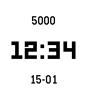

# Type

Type is an open source, minimalist watchface for Pebble, built for legibility and clean aesthetics.



## Features

- **Inter Typography:** Uses the Inter typeface for a modern, refined look.
- **High Contrast:** Black text on a white background for superior visibility on the Memory LCD.
- **Calm Tech:** No distractions. A subtle red line appears only when the battery drops below 20%.
- **Purely Local:** Uses on-device data only (Time & Health API). No Bluetooth required.

## Build From Source

Ensure you have the Pebble SDK installed.

```bash
# Build the project
pebble build

# Install to watch
pebble install --cloudpebble
```

## Credits

- **Inter Font:** Designed by Rasmus Andersson. Licensed under the [SIL Open Font License, Version 1.1](https://scripts.sil.org/OFL).
- **Screenshot Device Frame:** From the Rebble App Store.

## Development

Built with assistance from Gemini.

## License

[MIT](LICENSE) © 2026 Alexander Teinum.
